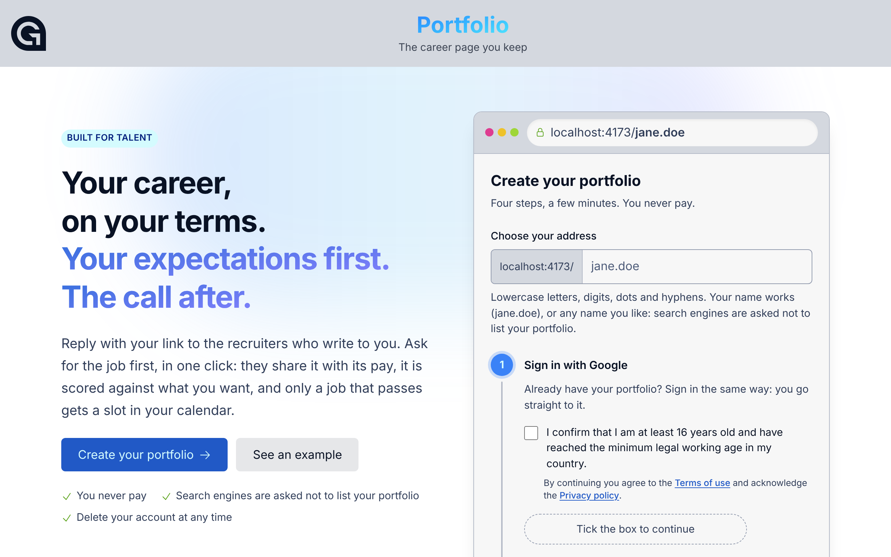
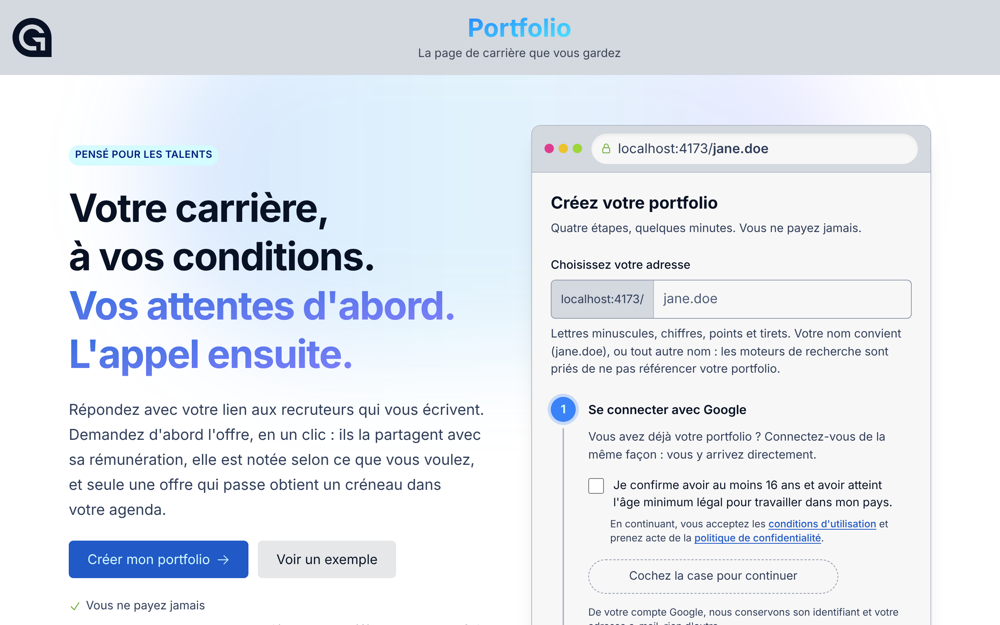
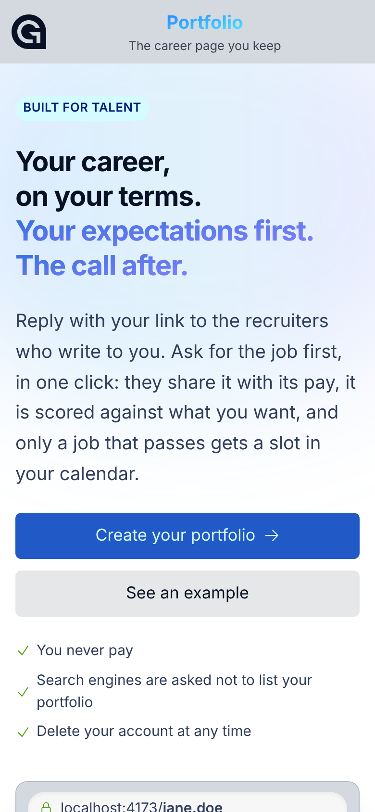
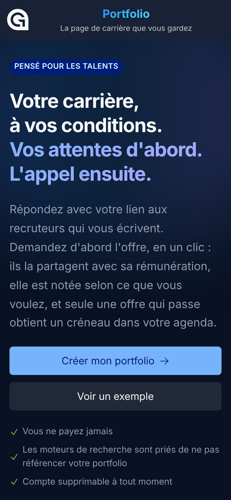
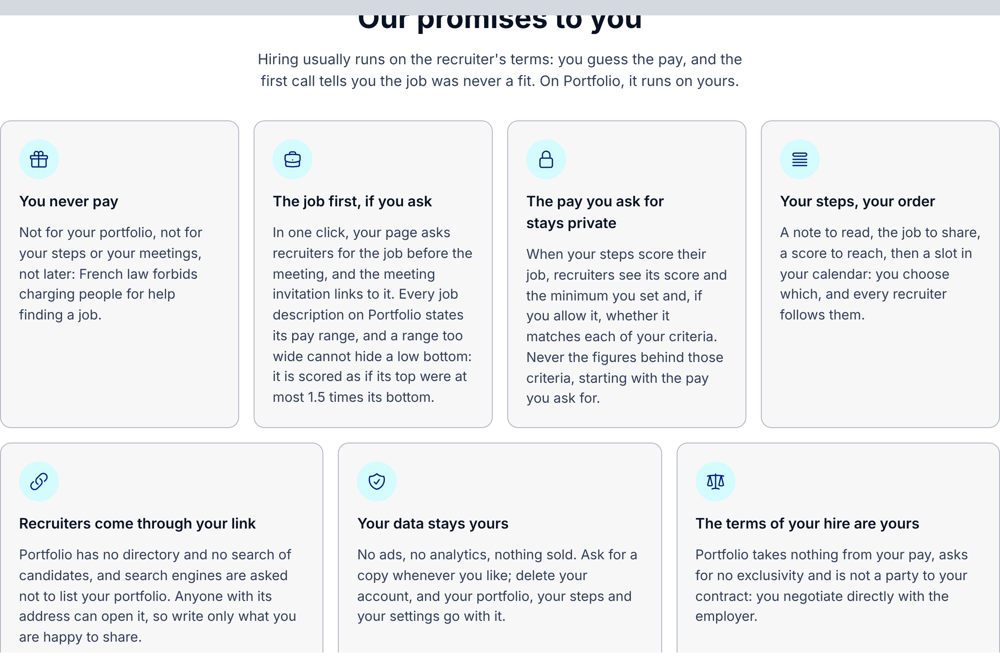
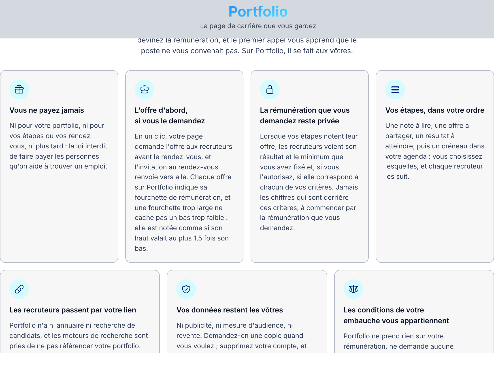
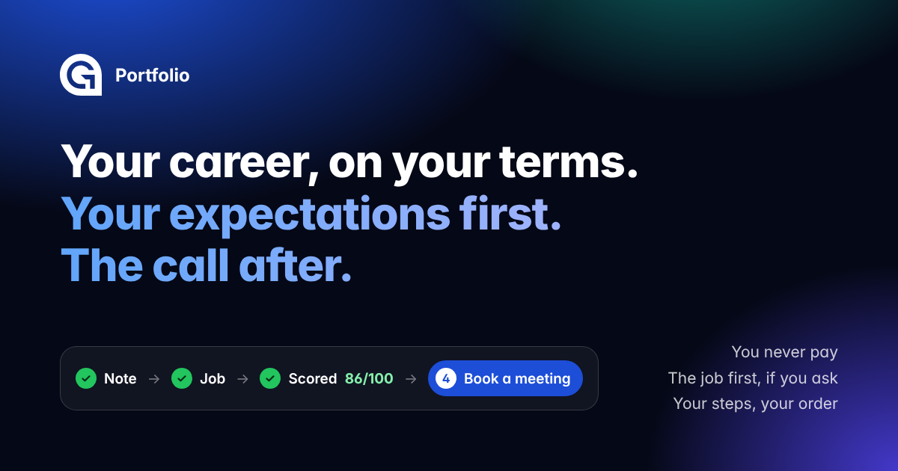
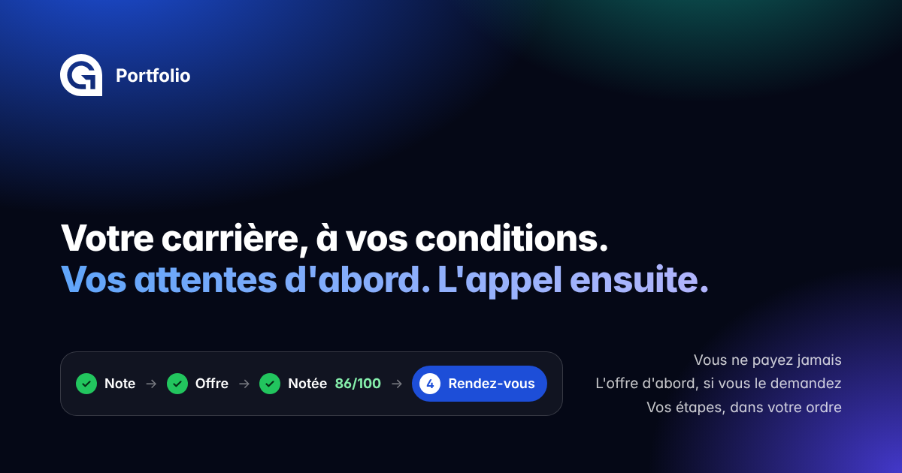

# PR #116: "Your expectations first"

Commit ad5723b: the landing leads with the candidate's expectations, not the pay. Desktop 1280 × 800 and phone 390 × 844 at device scale 2, against the real app running locally. The "before" of each is in the main gallery (`SCREENSHOTS.md` at 93dd475, section 1).

## Hero

**Desktop, English / French**

 

**Phone: English light / French dark**

 

## Our promises to you: "The job first, if you ask"

**Desktop, English / French**

 

## Share images (1200 × 630)

**English / French**

 
